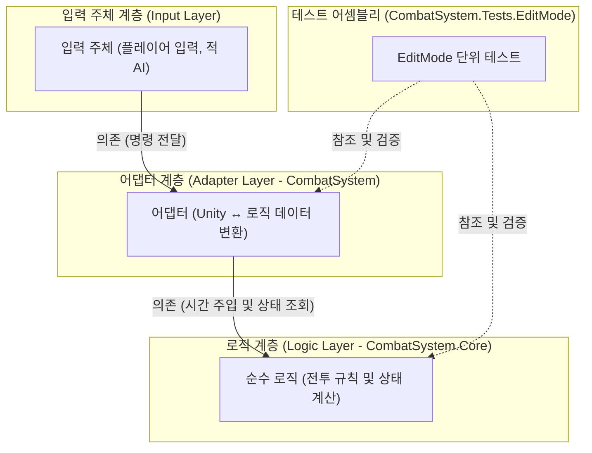
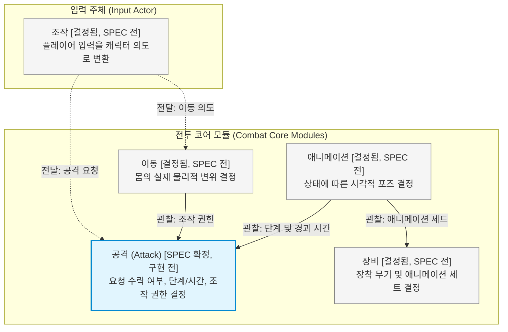

# God of War Combat System — Architecture

## 1. 개요 (Overview)
God of War 스타일 3인칭 근접 전투(Third-Person Melee Combat)의 구현 포트폴리오다. Unity 6를 기반으로 개발한다.

### 설계 원칙
- **단일 결정권(Decision Authority) 단위 모듈화**: 모듈은 규칙의 결정권을 기준으로 분리한다. 하나의 전투 규칙은 오직 단 하나의 모듈만 결정한다.
- **관찰 기반 연계(Observation-based Decoupling)**: 다른 모듈은 그 결정을 관찰(Observe)하여 따르며, 모듈 간에 직접적인 요청이나 데이터 전달로 결합하지 않는다.
- **엔진 독립적 로직 격리와 시간 주입(Time Injection)**: 전투 규칙은 Unity 엔진 종속성이 없는 순수 C# 로직 어셈블리(`CombatSystem.Core`)에 격리하고, Unity 측(`CombatSystem`)은 입출력 변환만 수행한다. 로직은 시간 경과를 인자(`Tick(float dt)`)로 주입받는다. (아키텍처 결정 이유는 [ADR 001](ADRs/001-humble-object-combat-logic.md) 참조)

---

## 2. 계층과 경계 (Layers and Boundaries)

시스템은 단방향 의존성(Unidirectional Dependency)을 갖는 3계층 아키텍처로 구성된다.

### 계층 정의 및 어셈블리 대응
1. **입력 주체(Input Actors)**: 플레이어 디바이스 입력 및 적 AI. "캐릭터가 수행할 의도(명령)"만 하위 계층으로 전달한다. 트레이닝 더미(Training Dummy)는 입력 주체 없이 동일한 캐릭터를 공유한다.
2. **어댑터 계층(Adapter Layer: `CombatSystem`)**: Unity 엔진 런타임과 순수 로직을 중계한다. Input System 입력 수신, `CharacterController` 물리 이동, `Animator` 포즈 동기화 및 물리 쿼리를 전담한다.
3. **로직 계층(Logic Layer: `CombatSystem.Core`, `noEngineReferences: true`)**: 전투 규칙과 상태 전이(State Transition)를 순수 C#으로 계산한다.
4. **테스트 어셈블리(Test Assembly: `CombatSystem.Tests.EditMode`)**: 어댑터와 로직 어셈블리를 모두 참조하여 규칙과 무할당(Zero-GC)을 검증한다.

### 계층 불변식 (Layer Invariants)
- 로직은 `UnityEngine`을 일절 참조하지 않는다. (`AGENTS.md` §3 참조, asmdef가 강제)
- 로직은 입력 장치(Hardware Devices)를 모른다. Input System은 어댑터만 참조한다.
- 로직은 수평면 2D(XZ 평면) 이동과 Y축 회전 각도(Yaw)만 계산하며 `System.Numerics.Vector2`를 사용한다. 수직 방향(중력, 착지 판정)은 어댑터가 전담한다.

---

## 3. 모듈 지도 (Module Map)

모듈 간의 관계는 "관찰해 따른다"와 "할 일을 넘긴다" 두 종류의 의존성으로만 구성된다.

> **범례 및 화살표 규칙**:
> - 화살표 방향: **누가 누구를 아는가 (의존 방향: A → B는 A가 B를 참조함)**
> - `A --> B` (실선): **관찰해 따른다** (B의 결정을 A가 관찰하여 준수)
> - `A -.-> B` (점선): **할 일을 넘긴다** (입력 주체 계층에서만 나가는 의도 전달)

### 미결 사항
- 공격 외 네 모듈의 정식 영문 식별자는 각 모듈의 SPEC 작성 착수 시 확정하며, 그전까지 역할 명칭으로 칭한다.
- 카메라 시점 회전을 담당할 모듈은 조작 모듈 SPEC 작성 시 확정한다.

### 모듈 불변식 (Module Invariants)
- 한 규칙은 오직 한 모듈만 결정한다.
- 물리적으로 몸을 실제로 옮기는 곳은 이동 모듈 단 하나뿐이다.
- 애니메이터 컨트롤러(Animator Controller)에는 규칙이 없으며, 순수 로직의 상태를 시각적으로 재생만 한다.

---

## 4. 프레임과 시간 모델 [방향] (Frame and Time Model)

단일 캐릭터의 1프레임 갱신 파이프라인(Frame Update Pipeline)은 다음 순서로 단일 진입점(Single Entry Point) 코드에서 명시적으로 통제한다.

| 순서 | 파이프라인 단계 | 주체 | 동작 및 책임 |
| :---: | :--- | :--- | :--- |
| 1 | 입력 전달 (Input Dispatch) | 입력 주체 → 모듈 | 이동 의도 벡터 및 공격 요청 전달 |
| 2 | 시간 결정 (Delta Time) | 캐릭터 오케스트레이터 | 유효 델타 타임 산출 (히트스탑 정지 중이면 `dt = 0`) |
| 3 | 공격 갱신 (Attack Tick) | 공격 (`Attack`) | 생명주기 단계 전이 및 이동/회전 조작 권한(Control Authority) 결정 |
| 4 | 이동 계산 (Motion Update) | 이동 | 조작 권한에 따라 변위 산출 (입력 속도 또는 루트 모션) |
| 5 | 물리 이동 (Physics Move) | 이동 | `CharacterController.Move`를 호출하여 몸을 1회 이동 |
| 6 | 애니메이션 갱신 (Anim Pose) | 애니메이션 | 공격 단계 및 경과 시간에 동기화하여 포즈와 레이어 가중치 갱신 |

### 순서 보장 원칙
Unity는 여러 객체 간의 콜백 호출 순서를 보장하지 않는다 ([Unity Execution Order 매뉴얼](https://docs.unity3d.com/6000.0/Documentation/Manual/execution-order.html)). 따라서 `DefaultExecutionOrder` 같은 엔진 속성에 기대지 않고, 캐릭터마다 단 하나의 제어 코드에서 위 순서를 직접 실행한다.

### 시간 모델
- 로직은 시스템 클럭을 조회하지 않고 외부에서 `Tick(float dt)`로 주입받는다.
- 시간은 캐릭터별 독립 로컬 시간 축(Local Time Scale)으로 흐르며, Unity의 전역 `Time.timeScale`은 사용하지 않는다.
- 결정론적 반응성의 정의는 `AGENTS.md` §3을 따른다.

---

## 5. 확장 지점 [방향] (Extension Points)

Phase 2 기능들이 결합할 아키텍처 결합점(Integration Points)만 명시한다. (동작 세부는 Phase 2 SPEC에서 확정)

- **비대칭 히트스탑 (Asymmetric HitStop)**:
  - 결합 위치: 4절 **2단계 (시간 결정)**에 결합.
  - 역할: 피격 및 적중 시 공격자와 피격자에게 서로 다른 정지 시간을 부여하며, 정지 중 `dt = 0`을 주입한다. 어댑터의 `Animator` 역시 `animator.speed = 0`으로 정지를 따른다.
- **판정 구간 (Hitbox Window)**:
  - 결합 위치: 로직의 **공격 데이터 Active 구간** 및 어댑터의 **물리 충돌 검사**에 결합.
  - 역할: 판정 구간 개방 타이밍은 로직이 결정하고, 실제 칼날 궤적의 공간 검사는 어댑터가 수행한다. (애니메이션 이벤트(Animation Event) 배제)
- **넉백 (Knockback)**:
  - 결합 위치: 4절 **4단계 (이동 계산)**에 결합.
  - 역할: 이동 모듈 계산식에 외부 충격 벡터로 가산된다. 몸을 따로 옮기는 독립 컴포넌트를 두지 않는다.
