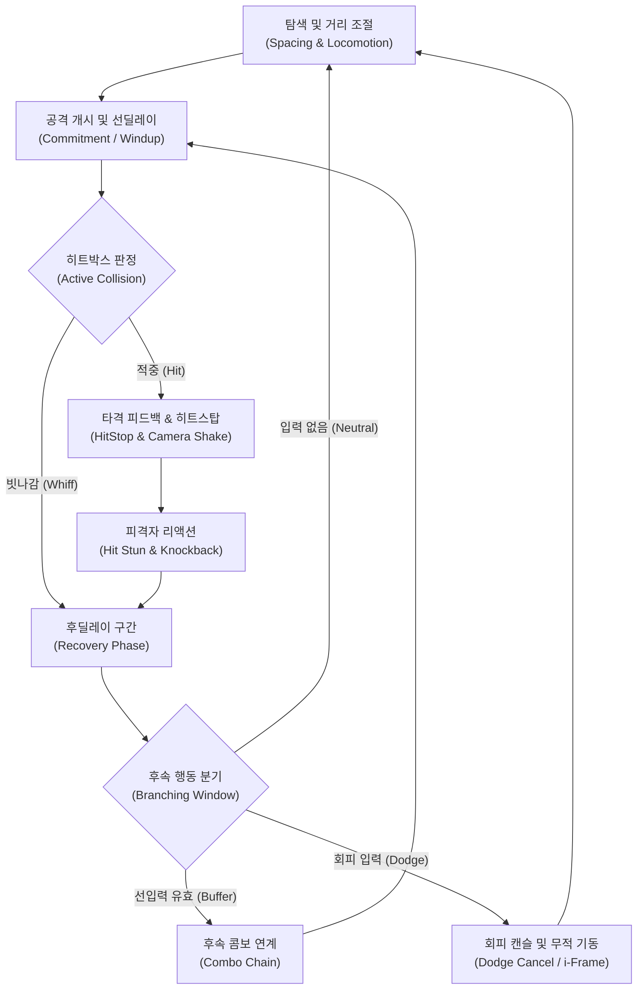
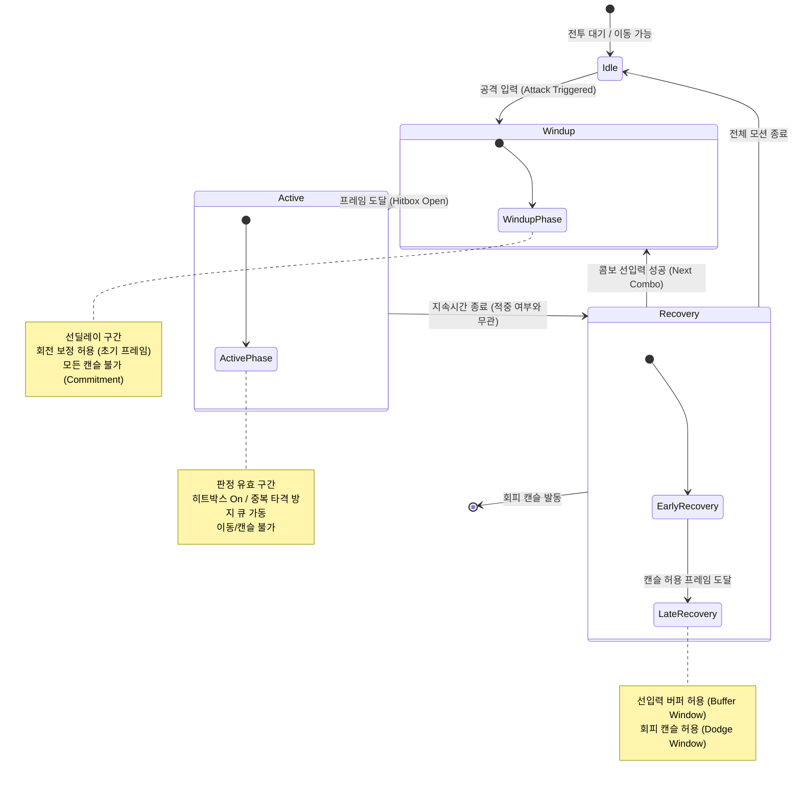
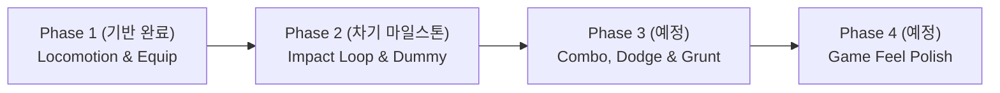

# God of War Master Combat Design Document

---

## 1. 프로젝트 개요 (Overview)

### 1.1. 엘리베이터 피치 (Elevator Pitch)
> **"갓 오브 워(God of War) 스타일의 숄더뷰 시점에서 펼쳐지는, 묵직한 중량감과 타격 피드백이 극대화된 근접 검술 전투 시스템"**

플레이어는 근거리 숄더뷰 카메라 시점에서 양손에 힘이 실린 묵직한 검(Sword)을 휘두르며 적과 정면으로 맞섭니다. 모든 공격은 휘두르는 궤적과 속도의 가감속이 뚜렷하며, 적중 순간 화면과 캐릭터가 순간 동결되는 히트스탑(Freeze Frame)과 카메라 임펄스 충격을 통해 칼날이 뼈와 살을 가르고 들어가는 원초적 타격감을 제공합니다.

### 1.2. 시스템 설계 목표 (System Design Objectives)
1. **결정론적 반응성 (Deterministic Responsiveness)**
   - 공격과 방어의 모든 상태를 60 FPS 기준의 명확한 프레임 데이터(Windup / Active / Recovery)와 선입력 버퍼(Input Buffering)로 통제하여, 조작의 오차 없는 반응성과 쾌적한 피드백을 보장합니다.
2. **확장 가능한 데이터 주도 구조 (Data-Driven Mechanics)**
   - 무기별 히트스탑 시간, 타격 궤적, 넉백 속도, 프레임 타이밍 등의 전투 파라미터를 데이터로 분리하여 신규 액션 및 무기군 확장에 유연하게 대응합니다.
3. **독립 검증이 가능한 모듈형 분리 (Decoupled System Architecture)**
   - 이동, 장비, 애니메이션, 공격 요청, 판정/피격 등, 시스템을 완전히 독립된 컴포넌트로 설계하여 모듈 단위의 안정성을 확보합니다.

---

## 2. 전투 디자인 3대 기둥 (Combat Design Pillars)

### Pillar 1. Weight & Impact (중량감과 타격감)
- **모션 가감속 (Kinetic Acceleration & Deceleration)**:
  - 무기를 휘두를 때 일정한 속도로 움직이지 않고, 예비 동작(Windup)에서의 서서히 축적되는 긴장감 ➔ 휘두르는 순간(Active)의 폭발적 가속 ➔ 타격 직후(Recovery)의 자연스러운 관성 감속 곡선을 유지합니다.
- **비대칭 히트스탑 (Asymmetric HitStop)**:
  - 공격이 유효 타깃에 적중하는 순간, 공격자와 피격자의 모션을 일시 동결하여 칼날이 저항을 뚫고 지나가는 물리적 마찰력을 표현합니다.
  - 피격자의 동결 시간을 공격자보다 길게 설정하여, 공격자에게 유리한 템포(Attacker Advantage)를 확보하고 타격 저항감을 극대화합니다.
- **카메라 임펄스 피드백 (Camera Impulse Shake)**:
  - 타격 적중 벡터와 무기 궤적에 비례한 방향성 카메라 진동을 적용하여 플레이어의 시각적 손맛을 완성합니다.

### Pillar 2. Commitment & Fluidity (판단과 유연성)
- **행동에 대한 책임 (Commitment)**:
  - 공격을 개시하면 선딜레이(Windup) 및 판정 유효 구간(Active) 동안은 이동이나 회피로 즉시 취소할 수 없습니다. 플레이어는 적의 상태를 보고 신중하게 공격 버튼을 눌러야 합니다.
- **조작의 유연성 (Fluidity & Input Buffering)**:
  - 후딜레이(Recovery) 구간에 진입하면 조작 쾌적성을 위해 **선입력 버퍼 윈도우(Buffer Window)**가 개방됩니다. 이 윈도우 동안 입력된 차기 콤보 공격은 후딜레이 종료 프레임에 오차 없이 즉시 연계됩니다.
- **위기 탈출 회피 캔슬 (Dodge Cancel)**:
  - 공격 후딜레이(Recovery) 후반부에는 적의 반격에 대처할 수 있도록 회피(Dodge) 명령을 통한 캔슬을 허용하며, 회피 시작 시 무적 프레임(i-Frame)을 부여하여 위기 탈출 기회를 제공합니다.

### Pillar 3. Clarity & Feedback (명확한 정보 전달)
- **명확한 전조 모션 (Telegraphing)**:
  - 적의 공격은 준비 동작(선딜레이) 동안 명확한 시각적/청각적 예비 신호를 노출하여 플레이어가 회피 또는 반격 타이밍을 인지할 수 있게 합니다.
- **타격 궤적 시각화 (Weapon Arc & Trail)**:
  - 무기 날(Blade)을 따라 전개되는 궤적 트레일(Trail VFX)을 통해 판정 영역의 공간적 크기와 속도감을 직관적으로 인지시킵니다.
- **피격 인과관계 피드백 (Hit Reaction & Knockback)**:
  - 피격된 대상은 타격 방향의 반대 벡터로 즉각적인 경직(Hit Stun) 모션과 지수 감쇄(Exponential Decay) 형태의 넉백(Knockback) 물리 이동을 겪습니다.

---

## 3. 코어 전투 루프 (Core Combat Loop)

전투 시스템의 코어 루프는 탐색부터 후딜레이 후속 행동 분기까지 유기적으로 순환하는 5단계 파이프라인으로 구성됩니다.

### 루프 단계별 상세 인터랙션
1. **탐색 및 거리 조절 (Spacing)**: 8방향 로코모션과 카메라 회전을 통해 공격 유효 사거리 내로 진입합니다.
2. **공격 개시 (Commitment)**: 공격 입력 시 [`CharacterAttack`](file:///c:/Users/chahoseong/Documents/Unity%20Projects/GodOfWarCombatSystem/Assets/Scripts/Character/CharacterAttack.cs)을 통해 전신 애니메이션 오버라이드가 트리거되며 선딜레이에 돌입합니다.
3. **판정 및 적중 (Collision & HitStop)**: 무기 히트박스가 적의 허트박스(Hurtbox)와 교차하면 단 1회의 적중 이벤트를 발행하고 양자 히트스탑을 발생시킵니다.
4. **피격 리액션 (Reaction)**: 피격 대상은 데미지를 수신하고 경직 애니메이션 재생 및 후방 넉백 벡터를 적용받습니다.
5. **후속 분기 (Branching)**: 후딜레이 구간에서 다음 공격 입력(콤보), 회피 입력(캔슬), 또는 기본 자세 복귀(중립)를 결정합니다.

---

## 4. 전투 상태 머신 및 타이밍 구조 (Combat Timing & States)

### 4.1. 공격 1타 생명주기 (Attack Lifecycle FSM)

단일 공격 액션은 철저히 구분된 3단계 내부 상태(State)를 거치며, 각 상태에 따라 조작 권한과 시스템 반응이 엄격히 제어됩니다.

> [!NOTE]
> **히트스탑(HitStop)은 상태가 아니라, 어느 상태에든 걸리는 시간 정지입니다.**
> - 적중 시 공격자와 피격자에게 각각 동결이 걸리며, 카메라 임펄스가 발생합니다.
> - 동결 중에는 현재 상태의 진행 시간이 멈추고 모든 조작이 불가합니다(4.2 매트릭스의 HitStop 행).
> - 동결이 풀리면 같은 상태의 같은 시점부터 이어집니다. 따라서 Active 도중 적중해도 남은 Active는 그대로 진행되며, 한 번의 휘두르기로 궤적에 걸린 다른 대상도 맞힐 수 있습니다.

### 4.2. 타이밍 아키텍처 및 조작 권한 매트릭스 (Timing Architecture & Authority Matrix)

공격 모션은 일정한 묵직함과 타격 리듬을 유지하기 위해 **타이밍 비율 모델(Timing Ratio Model)**을 따르며, 생명주기 구간에 따라 플레이어의 조작 권한이 결정론적으로 제어됩니다.

#### [타이밍 비율 가이드라인 (Timing Ratio Model)]
- **선딜레이 (Windup, 약 20~25%)**: 힘을 모으고 긴장감을 형성하는 예비 동작 구간
- **판정 구간 (Active, 약 10~15%)**: 최고 속도로 무기를 휘두르며 히트박스가 개방되는 구간
- **후딜레이 (Recovery, 약 60~65%)**: 타격 후 관성을 제어하고 후속 행동(콤보/회피)으로 연결되는 여운 구간

> [!NOTE]
> 개별 모션(Slash 1, 2, Finisher 등)의 1프레임 단위 세부 수치와 데미지 밸런스는 본 마스터 문서에 종속되지 않으며, 하위 무기별 명세서(`Specs/`) 및 데이터 에셋에서 독립적으로 관리·조정됩니다.

#### [상태별 조작 권한 매트릭스 (Player Control Authority Matrix)]

| 상태 (Phase) | 이동 (Locomotion) | 방향 회전 (Rotation) | 공격 선입력 (Buffer) | 회피 캔슬 (Dodge Cancel) |
| :--- | :---: | :---: | :---: | :---: |
| **Windup (선딜)** | ❌ 불가 | ⚠️ 초기 일부 프레임 허용 | ❌ 불가 | ❌ 불가 |
| **Active (판정)** | ❌ 불가 | ❌ 불가 | ❌ 불가 | ❌ 불가 |
| **HitStop (동결)** | ❌ 불가 | ❌ 불가 | ❌ 불가 | ❌ 불가 |
| **Recovery (초기 후딜)** | ❌ 불가 | ❌ 불가 | ❌ 불가 | ❌ 불가 |
| **Recovery (후기 후딜)** | ❌ 불가 | ⚠️ 회피 방향 전환 허용 | ✅ 선입력 큐잉 허용 | ✅ 즉시 캔슬 허용 |

### 4.3. 타격 피드백 역학 (Kinetic Feedback Mechanics)

- **비대칭 히트스탑 원리 (Asymmetric HitStop Principle)**:
  - 타격 적중 시 공격자보다 **피격자의 동결 시간을 상대적으로 더 길게 설정**합니다.
  - 이는 공격자가 먼저 경직에서 풀려나 후속 행동을 준비할 수 있는 공격자 이점(Attacker Advantage)을 부여함과 동시에, 칼날이 적의 육체를 가르고 빠져나오는 저항감을 시각적으로 극대화합니다.
- **감쇄 기반 넉백 물리 (Decaying Knockback Model)**:
  - 넉백은 단순 순간 좌표 이동(Teleport)이 아닌, 피격 방향으로의 초기 충격 속도(Impulse Velocity) 부여 후 지수 감쇄(Decay/Drag) 형태의 물리 이동을 적용하여 무게감과 마찰력을 전달합니다.

---

## 5. 전투 기능 로드맵 (Combat Feature Roadmap)

전체 전투 시스템은 4단계 점진적 마일스톤으로 구축되며, 각 마일스톤은 플레이어와 대상 간의 명확한 인터랙션 완결성을 갖습니다.

### Phase 1. 전투 기반 및 무기 조작 (Combat Foundation & Weapon Control)
묵직한 근접 전투를 성립시키기 위한 숄더뷰 조작계와 무기 장착, 공격 모션 전신 통제 인프라를 확립하는 단계입니다.
- **주요 기능 명세**:
  - **전투 지향형 숄더뷰 로코모션 (Combat-Oriented Locomotion)**: 카메라 시선을 유지한 채 적과의 거리를 섬세하게 조절하는 8방향 스트레이핑(Strafe/Walk)과 거리를 단숨에 좁히는 질주(Sprint), 급회전 시 가벼운 미끄러짐을 방지하는 방향 회전 제어
  - **무기 장착 및 전투 자세 전환 (Weapon Mounting & Stance Switching)**: 캐릭터 본 소켓에 무기를 정밀하게 마운트하고, 무기 장착 상태에 따라 즉시 상체 전투 포즈(Combat Stance)로 전환되는 동적 애니메이션 세트 주입
  - **전신 공격 모션 오버라이드 (Full-Body Attack Execution)**: 공격 발동 시 하체 로코모션을 전신 공격 애니메이션으로 즉시 덮어써, 공격 동작 중 발이 미끄러지는(Foot Sliding) 현상을 차단하고 일관된 타격 궤적 보장
  - **결정론적 전투 입력 브릿지 (Deterministic Combat Input Bridge)**: 시점 회전(Pitch/Yaw), 8방향 이동 벡터, 공격 트리거 입력을 전투 시스템으로 지연 없이 무결하게 전달하는 인터페이스

### Phase 2. 타격 판정 및 피격 완결 (차기 마일스톤)
플레이어의 무기 휘두르기가 실제 대상에게 전달되어 타격감이 성립하는 완전한 **타격-피격 루프(Impact Loop)**를 완성합니다.
- **주요 기능 명세**:
  - **히트박스 감지기 (Hitbox Detection)**: 무기 궤적 및 트리거 기반 충돌 검출, 단일 공격 내 동일 타깃 중복 타격 방지(Target Filter Queue)
  - **피격 시스템 (Hurtbox & Damage Receiver)**: 충돌체 레이어 분리, 데미지 전달, 방향성 피격 경직(Hit Stun) 재생
  - **히트스탑 컨트롤러 (HitStop Controller)**: 적중 시 공격자 및 피격자의 프레임 독립 동결 파이프라인
  - **넉백 물리 수신기 (Knockback Receiver)**: 피격 방향 벡터 기반 지수 감쇄 물리 이동
  - **트레이닝 더미 (Training Dummy)**: 제자리에 서서 플레이어의 공격을 받아내며 경직, 넉백, 히트스탑을 온전히 검증하는 반응형 샌드백 타깃

### Phase 3. 콤보 분기 및 공방 완성 (예정)
조작의 쾌적성을 극대화하는 선입력 큐와 다단 콤보 분기, 적의 공격에 대응하는 수비 인터랙션을 구축합니다.
- **주요 기능 명세**:
  - **콤보 그래프 (Combo Branching System)**: 1타 ➔ 2타 ➔ 피니셔로 이어지는 콤보 트리 전이 및 상태 관리
  - **선입력 버퍼 큐 (Input Buffer Queue)**: 후딜레이(Recovery) 윈도우 내 키 입력을 큐잉하고 다음 프레임에 즉시 릴리즈
  - **회피 캔슬 및 무적 판정 (Dodge Cancel & i-Frame)**: 후딜레이 도중 회피 기동으로의 상태 전이 및 초기 무적 프레임(i-Frame) 처리
  - **기본 그런트 (Basic Grunt)**: 단순 공격형 적. 플레이어에게 접근 후 명확한 전조 모션(Telegraph)을 거쳐 1타 공격을 시도하여, 플레이어의 회피 및 피격 타이밍 검증

### Phase 4. 게임 필 연출 고도화 (예정)
액션의 시각적·청각적 임팩트를 극대화하는 연출 레이어를 통합합니다.
- **주요 기능 명세**:
  - **Cinemachine Impulse 카메라 셰이크**: 타격 적중 강도에 따른 방향성 카메라 흔들림 프로파일 적용
  - **무기 궤적 트레일 (Weapon Trail VFX)**: 베기 궤적을 강조하는 메시 트레일 이펙트
  - **피격 타격음 및 스파크 이펙트 (Hit VFX & Audio)**: 적중 좌표(Hit Point)에 정확한 파티클 스파크 및 묵직한 타격 사운드 재생

---

## 6. 제외 범위 (Out of Scope)

프로젝트의 핵심 목표인 **"묵직한 근접 전투 감각(Combat Feel)의 수학적·시스템적 완성"**에 집중하기 위해 아래 항목들은 본 시스템의 범위에서 명확히 제외합니다.

1. **대규모 군중 AI 및 복잡한 협공 토큰 시스템**
   - 1:1 및 소수 정예 적과의 긴장감 있는 근접 인터랙션에 집중하며, 수십 마리가 동시 난투를 벌이는 대규모 군중 AI 및 시야 밖 공격 방지 토큰 시스템은 제외합니다.
2. **복잡한 RPG 인벤토리 및 장비 스탯 파밍 시스템**
   - 무기 교체 및 소켓 장착 기능에 집중하며, 레벨업, 수치형 스탯 계산, 인벤토리 슬롯 관리, 내구도 등의 RPG 요소는 제외합니다.
3. **네트워크 멀티플레이어 동기화**
   - 60 FPS 결정론적 로컬 프레임 반응성과 히트스탑 피드백을 보장하기 위해 락스텝이나 클라이언트 예측 동기화는 고려하지 않습니다.
4. **다중 분기 마법 및 방대한 스킬 트리**
   - 검을 활용한 체계적인 평타 콤보와 회피 기동의 물리적 완성도에 집중하며, 원거리 마법 투사체나 분기형 스킬 트리는 제외합니다.
